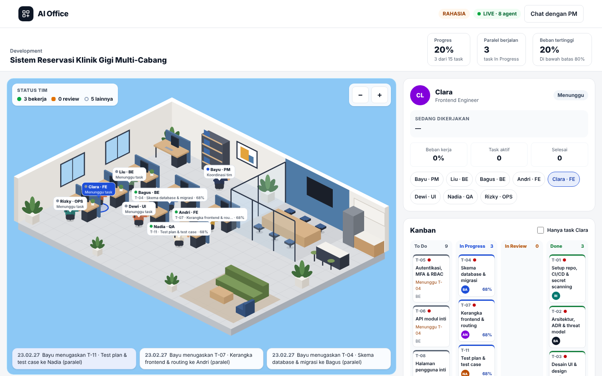

# AI Office

Virtual office tempat tim **AI agent** membangun produk digital untuk klien. Klien memilih jenis proyek, berkonsultasi dengan konsultan AI, menyetujui setiap tahap, lalu memantau tim agent bekerja secara realtime di **kantor isometrik** lengkap dengan **Kanban**.



## Alur produk

| Fase | Agent | Gerbang persetujuan klien |
|---|---|---|
| Konsultasi bisnis | Raka · AI Business Consultant | Setujui arah solusi |
| Syarat & Ketentuan | Raka | Setujui S&K (versi dokumen dicatat) |
| Analisis kebutuhan | Sinta · Business Analyst | Setujui dokumen kebutuhan (BRD) |
| Penyusunan rencana | Arya · Solution Architect + Bayu · PM | Setujui tech stack, tim, dan task |
| Development | Bayu (PM) + tim agent (1–10 orang) | Review hasil |

Saat development, **PM agent** (scheduler di `apps/server/src/orchestrator/scheduler.ts`):

- hanya memulai task yang semua dependensinya sudah **Done** (DAG, siklus ditolak),
- menjalankan task siap secara **paralel** pada agent berbeda,
- membatasi **1 task aktif per agent** (WIP limit) agar tidak ada yang overload,
- memilih agent sesuai peran lalu yang **bebannya paling ringan**, dengan peran cadangan bila perlu,
- mengirim setiap task selesai ke **reviewer** (QA, rekan sejawat, atau PM) sebelum Done.

## Arsitektur

```
apps/web      Next.js 16 (App Router) + Tailwind + PixiJS (kantor isometrik)
apps/server   Fastify 5 + WebSocket, Drizzle ORM (PostgreSQL / PGlite), Anthropic SDK
packages/shared  Tipe, skema zod, dan event realtime bersama
```

- **LLM**: bila `ANTHROPIC_API_KEY` diisi, setiap agent memakai Claude dengan *structured output* (tool use + validasi zod). Tanpa key, server berjalan dalam **mode mock** dengan skrip agent deterministik, cocok untuk demo dan test.
- **Realtime**: event `project`/`message`/`agent`/`task`/`activity` disiarkan lewat WebSocket per proyek. Untuk multi-instance, ganti `EventBus` dengan Redis pub/sub.
- **Database**: PostgreSQL di produksi; PGlite (Postgres WASM in-process) untuk dev dan test tanpa Docker.

## Kontrol keamanan (selaras ISO/IEC 27001:2022 Annex A)

| Kontrol | Implementasi |
|---|---|
| A.5.15 / A.8.3 Kontrol akses | Setiap endpoint & WebSocket memeriksa kepemilikan proyek |
| A.8.5 Autentikasi aman | Hash kata sandi scrypt, sesi token acak (di-hash di DB), cookie `httpOnly` + `SameSite=Strict`, penguncian akun setelah 5 kali gagal, rate limit login |
| A.8.15 Logging | Audit trail berantai hash SHA-256, **append-only** (trigger DB menolak UPDATE/DELETE), `verifyChain()` |
| A.5.12 Klasifikasi | Proyek otomatis berlabel `confidential` |
| A.8.24 Kriptografi | Rahasia hanya via env; TLS di reverse proxy produksi |
| A.8.26 / A.8.28 Keamanan aplikasi | Validasi input zod, body limit, Helmet, header keamanan Next, hanya JSON untuk request yang mengubah data (anti-CSRF), cek Origin pada WebSocket, prompt agent memperlakukan isi chat sebagai data (mitigasi prompt injection) |

> Kontrol di atas adalah fondasi teknis. Sertifikasi ISO 27001 tetap memerlukan ISMS, kebijakan, risk assessment, dan audit eksternal.

## Menjalankan

```bash
npm install
cp .env.example .env          # opsional; tanpa .env berjalan dengan PGlite + mode mock

# Terminal 1: API (port 4000)
npm run dev:server
# Terminal 2: Web (port 3000)
npm run dev:web
```

Buka http://localhost:3000, daftar akun, pilih jenis proyek, lalu ikuti percakapan.

Dengan PostgreSQL: `docker compose up -d`, lalu set `DATABASE_URL` sebelum menjalankan server.

## Test

```bash
npm test          # unit test scheduler + test end-to-end alur klien (PGlite + mode mock)
npm run typecheck
```

Test end-to-end memverifikasi: isolasi akses antar pengguna, urutan gerbang persetujuan, task paralel, tidak ada agent dengan >1 task aktif, dependensi dihormati, semua task direview, dan audit trail utuh serta append-only.

## Roadmap berikutnya

- Aset ilustrasi isometrik (karakter berjalan & duduk) untuk menggantikan gambar vektor bawaan renderer
- Output agent menjadi commit nyata ke repo klien (GitHub App) + preview deployment
- MFA (TOTP/WebAuthn) dan SSO untuk klien korporat
- Redis untuk pub/sub & antrian job, worker agent terpisah
- Billing & estimasi biaya per sprint
